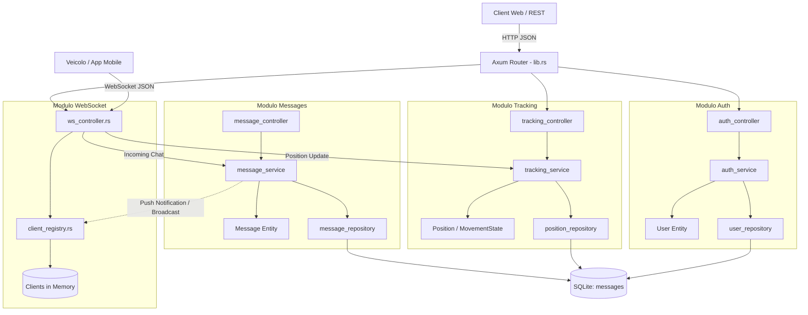
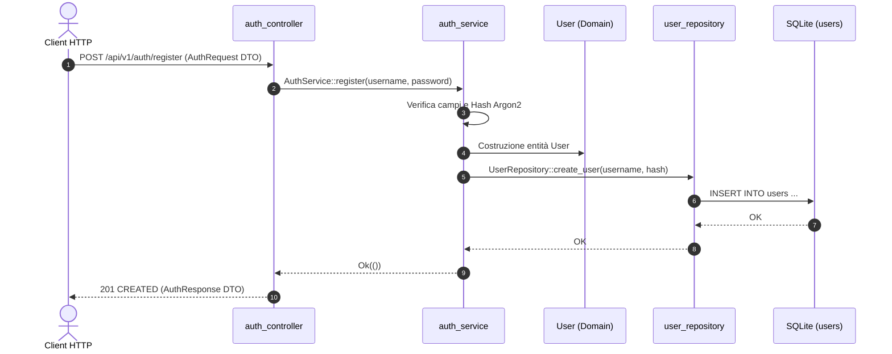
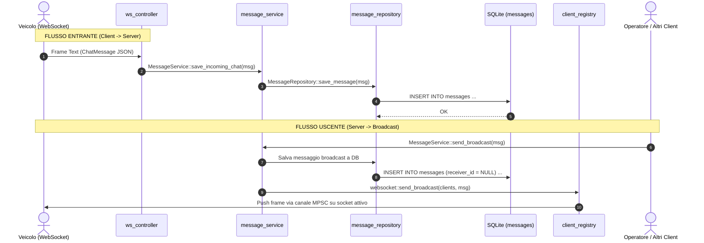

# Architettura del Backend: Monolite Modulare (Georuggine Server)

Questo documento descrive in dettaglio l'organizzazione architetturale del backend **`georuggine-server`**, basata sul paradigma del **Monolite Modulare (Modular Monolith)** e guidata dai principi del **Domain-Driven Design (DDD)** e della **Clean Architecture**.

---

## 1. Visione d'Insieme e Principi Guida

Il sistema è strutturato verticalmente per **Domini di Business (Bounded Context)** invece di essere partizionato orizzontalmente per strati tecnici globali (es. tutti i controller in una cartella, tutti i modelli in un'altra).

### Principi Architetturali Chiave:
1. **Vertical Slicing (Partizionamento per Dominio):** Ogni modulo (`auth`, `tracking`, `messages`, `websocket`) è un'unità autonoma che racchiude tutto ciò che serve per quella specifica area funzionale.
2. **Information Hiding (Incapsulamento):** Ogni modulo espone all'esterno **esclusivamente** la propria sotto-cartella `/api`. I dettagli interni (tabelle SQL, query, logiche di servizio ed entità interne) sono privati.
3. **Database Ownership (Tabelle Private):** Ciascun modulo è il proprietario esclusivo delle proprie tabelle nel database SQLite:
   - `auth` gestisce la tabella `users`.
   - `tracking` gestisce la tabella `positions`.
   - `messages` gestisce la tabella `messages`.
4. **Disaccoppiamento tra Dominio e Trasporto:** La logica di business e le entità non dipendono dai dettagli del protocollo di rete (HTTP o WebSocket).

---

## 2. I Domini Applicativi (Bounded Contexts)

L'applicazione è suddivisa in 4 moduli principali situati in `src/`:

```text
src/
├── auth/          # Dominio: Registrazione, Autenticazione e Gestione Utenti
├── tracking/      # Dominio: Posizioni geografiche, Tracciamento e Stati di Movimento
├── messages/      # Dominio: Messaggistica testuale (Broadcast, Direct, Storico)
├── websocket/     # Infrastruttura di Rete: Connessioni real-time, canali e protocollo
├── database.rs    # Infrastruttura condivisa: Inizializzazione SqlitePool e DDL
├── lib.rs         # Assemblaggio applicativo: AppState e composizione router Axum
└── main.rs        # Entry point: TCP Listener e bootstrap del server
```

### 2.1 `auth` (Autenticazione & Identità)
- **Scopo:** Gestire la registrazione, il login e le credenziali degli utenti del sistema.
- **Responsabilità:**
  - Hashing sicuro delle password tramite algoritmo **Argon2**.
  - Verifica delle credenziali e rilascio di token di sessione (JWT).
  - Gestione della persistenza sulla tabella `users`.

### 2.2 `tracking` (Tracciamento Flotta & Posizioni)
- **Scopo:** Monitorare la telemetria e la mobilità dei veicoli/utenti (Requisito 1.2).
- **Responsabilità:**
  - Acquisizione e validazione degli aggiornamenti periodici di posizione ($x, y$, timestamp).
  - Tracciamento dello stato di mobilità (`Stopped`, `Moving`, `Disconnected`).
  - Gestione della persistenza sulla tabella `positions`.

### 2.3 `messages` (Comunicazione & Chat)
- **Scopo:** Gestire la messaggistica bidirezionale tra server/centrale e la flotta di veicoli (Requisito 1.3).
- **Responsabilità:**
  - Invio di messaggi in broadcast a tutti i veicoli.
  - Invio di messaggi diretti a un singolo destinatario (`receiver_id`).
  - Ricezione e archiviazione dei messaggi inviati dai veicoli verso il server.
  - Gestione della persistenza sulla tabella `messages`.

### 2.4 `websocket` (Gateway di Comunicazione Real-Time)
- **Scopo:** Gestire lo strato di trasporto real-time full-duplex tramite WebSocket.
- **Responsabilità:**
  - Upgrade delle connessioni HTTP a WebSocket (`/ws` e `/api/v1/ws`).
  - Mantenimento del registro in memoria delle connessioni attive (`Clients`).
  - Distribuzione asincrona dei messaggi tramite canali MPSC non bloccanti per evitare che client lenti rallentino gli altri.
  - Routing dei messaggi in ingresso verso i rispettivi domini (`tracking` per le coordinate, `messages` per la chat).

---

## 3. Anatomia delle Sottocartelle di Modulo

Ogni singolo dominio implementa internamente la medesima struttura modulare a 5 livelli:

```text
src/<dominio>/
├── api/             # [PUBBLICO] Contratto esterno del modulo
│   ├── dto.rs       # Data Transfer Objects serializzabili (richieste e risposte)
│   └── mod.rs
├── domain/          # [PRIVATO] Cuore del business
│   ├── ...          # Entità con identità univoca e Value Objects
│   └── mod.rs
├── services/        # [PRIVATO] Casi d'uso e logica applicativa
│   ├── ...          # Orchestrazione delle operazioni, validazioni e business rules
│   └── mod.rs
├── repository/      # [PRIVATO] Persistenza e accesso ai dati
│   ├── ...          # Query SQL isolate sulla tabella di competenza
│   └── mod.rs
├── controllers/     # [PRIVATO] Entry points di rete
│   ├── ...          # Handler Axum HTTP / listener di protocollo
│   └── mod.rs
└── mod.rs           # Re-export del contratto pubblico verso l'esterno
```

### Livello 1: `/api` (Interfaccia Pubblica / Contratti)
- **Visibilità:** `pub` (esportato verso gli altri moduli e verso il client).
- **Contenuto:** 
  - **DTO (Data Transfer Objects):** Strutture dati annotate con `serde::{Serialize, Deserialize}` usate per inviare e ricevere informazioni oltre i confini del modulo (es. `AuthRequest`, `PositionUpdate`, `ChatMessage`).
  - Non include alcuna logica di business né dettagli sul database.

### Livello 2: `/domain` (Modello & Entità di Dominio)
- **Visibilità:** `pub(crate)` o privato del modulo.
- **Contenuto:**
  - **Entities:** Strutture dati con un'identità persistente (es. `User`, `Position`, `Message`).
  - **Value Objects / Enum di Stato:** Tipi immutabili che modellano regole di dominio (es. `MovementState` con le varianti `Stopped`, `Moving`, `Disconnected`).
  - **Logica Pura:** Validazione delle invarianti di business e metodi di calcolo indipendenti da database o framework di rete.

### Livello 3: `/services` (Casi d'Uso & Business Logic)
- **Visibilità:** `pub(crate)` (chiamabile dai controller del modulo o da altri servizi tramite interfacce esposte).
- **Contenuto:**
  - Classi di orchestrazione (es. `AuthService`, `TrackingService`, `MessageService`).
  - Ricevono le entità o i comandi, applicano algoritmi (hashing con Argon2, calcolo transizioni di stato), invocano il repository per la persistenza ed emettono notifiche.
  - Gestione degli errori di dominio tramite enum dedicati (es. `RegisterError`, `LoginError`).

### Livello 4: `/repository` (Persistenza & I/O)
- **Visibilità:** Privato del modulo (`pub(crate) mod repository`).
- **Contenuto:**
  - Metodi asincroni per query `SELECT`, `INSERT`, `UPDATE`, `DELETE` tramite `sqlx`.
  - Converte le righe SQLite nelle corrispondenti entità del livello `/domain`.
  - **Isolamento:** Nessun modulo può eseguire query su tabelle appartenenti ad altri domini.

### Livello 5: `/controllers` (Adattatori Web & Protocollo)
- **Visibilità:** Privato del modulo, salvo la funzione di esportazione delle rotte registrate nel router principale.
- **Contenuto:**
  - Handler HTTP di Axum che estraggono i parametri (`Json<T>`, `State<AppState>`).
  - Traduzione dei risultati dei servizi nei codici di risposta HTTP standard (`StatusCode::OK`, `StatusCode::CREATED`, `StatusCode::UNAUTHORIZED`, ecc.).

---

## 4. Diagrammi dei Flussi Dati

### 4.1 Architettura Globale dei Componenti



---

### 4.2 Flusso di Registrazione / Login (HTTP REST)



---

### 4.3 Flusso Bidirezionale Messaggistica (WebSocket & Persistenza)



---

## 5. Regole di Manutenzione del Codice

1. **Non bypassare il Dominio con i DTO:** I repository e i servizi non devono accettare DTO di rete per operazioni interne; i DTO vanno convertiti in entità di dominio (`Position`, `User`, `Message`) all'ingresso.
2. **Nessuna dipendenza circolare:** Un modulo può dipendere dall'interfaccia `/api` di un altro modulo, ma mai dai suoi file interni `/domain`, `/services` o `/repository`.
3. **Persistenza sicura:** Qualsiasi messaggio o stato di telemetria inviato in broadcast o in real-time deve essere storicizzato nel repository appropriato prima o contestualmente alla trasmissione di rete.


---

## 6. Architettura del Client Tauri (Georuggine Client)

Anche il backend desktop di **`georuggine-client`** (`src-tauri/src/`) adotta la medesima struttura modulare a 5 livelli del server, allineandosi ai principi di **Clean Architecture** e **Domain-Driven Design (DDD)**.

```text
src-tauri/src/
├── auth/          # Dominio: Sessione utente, REST Login & Register
├── messages/      # Dominio: Creazione e invio messaggi di chat (Produttore 1)
├── tracking/      # Dominio: Lettura coordinate da file e tracking periodico (Produttore 2)
├── websocket/     # Dominio/Rete: Gestione canale full-duplex WS (Task 1 Trasmissione, Task 2 Ricezione)
├── state.rs       # Stato globale condiviso (AppState, sincronizzazione MPSC e AbortHandle)
├── lib.rs         # Configurazione runtime Tauri, lifecycle eventi finestra e invoke_handler
└── main.rs        # Entry point dell'eseguibile desktop
```

### 6.1 Anatomia delle Sottocartelle del Client

Ogni dominio applicativo (`auth`, `messages`, `tracking`, `websocket`) rispetta i 5 livelli standard:

1. **`api/` (Contratto Pubblico & DTO):** Strutture dati scambiate con il frontend React o inviate sulla rete (`AuthRequest`, `AuthResponse`, `PositionUpdate`, `ChatMessage`, `ClientIncomingMessage`).
2. **`domain/` (Entità & Tipi Puri):** Modelli interni dell'applicazione (`UserSession`, `CoordinatePoint`, `Message`, costanti di configurazione rete).
3. **`services/` (Casi d'Uso & Logica Applicativa):**
   - `AuthService`: chiamate HTTP REST verso le API di autenticazione del server (`/auth/register`, `/auth/login`).
   - `MessageService`: costruzione e accodamento thread-safe dei messaggi di chat sul canale MPSC.
   - `TrackingService`: orchestrazione del Task 3 di tracciamento asincrono periodico a 30s da file di coordinate.
   - `WsService`: gestione della connessione WebSocket, Task 1 (trasmissione da canale MPSC a socket) e Task 2 (ricezione da socket ad eventi Tauri).
4. **`repository/` (Persistenza e Data Access):**
   - `SessionRepository`: gestione thread-safe della sessione utente in memoria nello stato condiviso.
   - `CoordinateRepository`: ricerca dinamica, parsing e fallback delle coordinate da file locali (`coordinates.json`, `positions.json`, `coordinates.csv`).
5. **`controllers/` (Entry Point IPC Tauri):**
   - Comandi esposti all'interfaccia grafica tramite `#[tauri::command]` (`register`, `login`, `logout`, `get_current_user`, `send_chat_message`).
