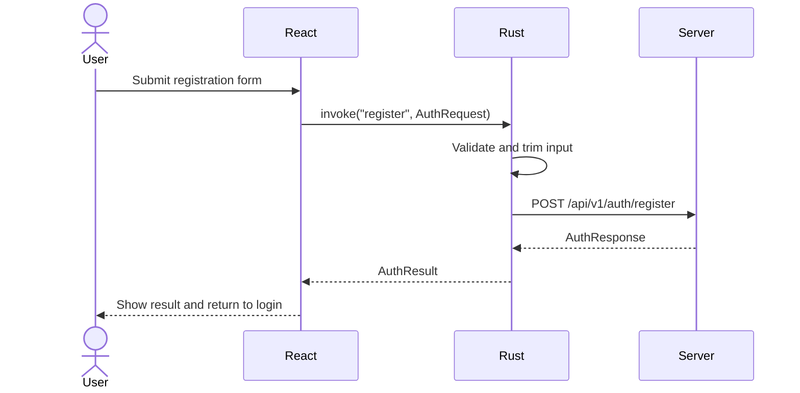
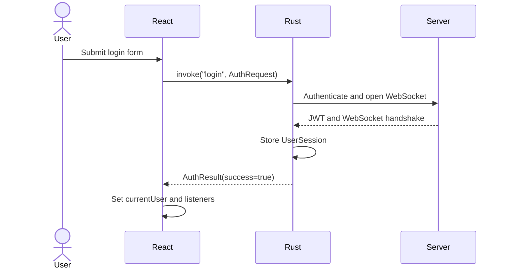
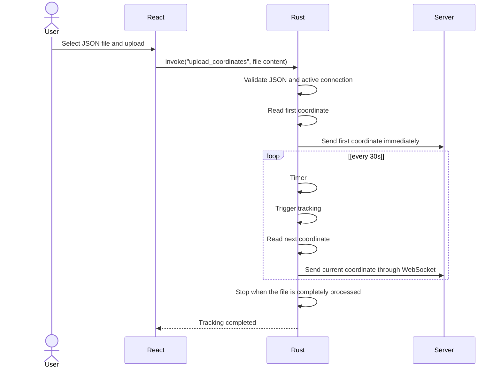
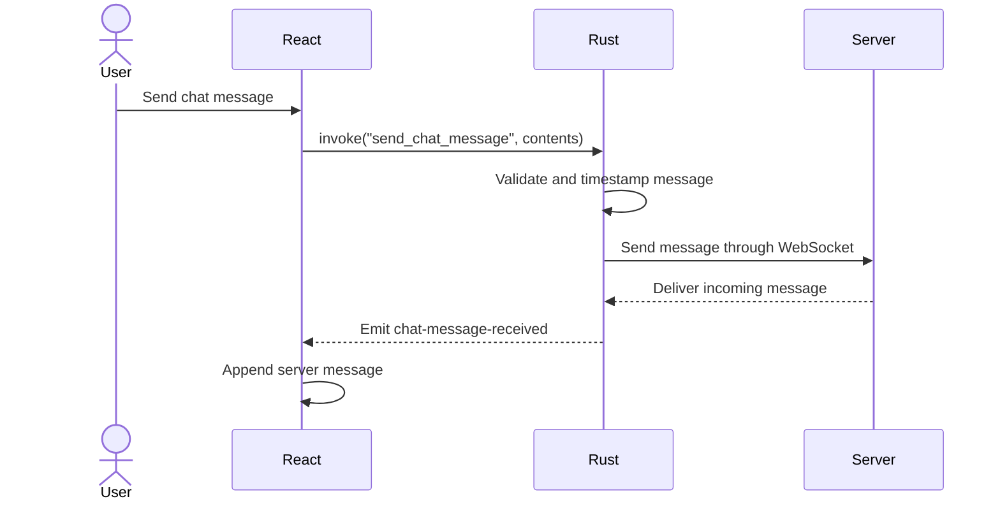
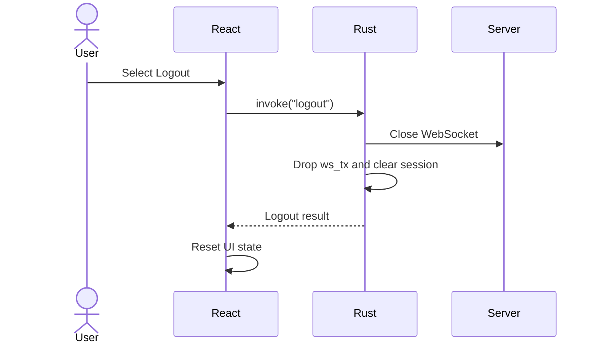
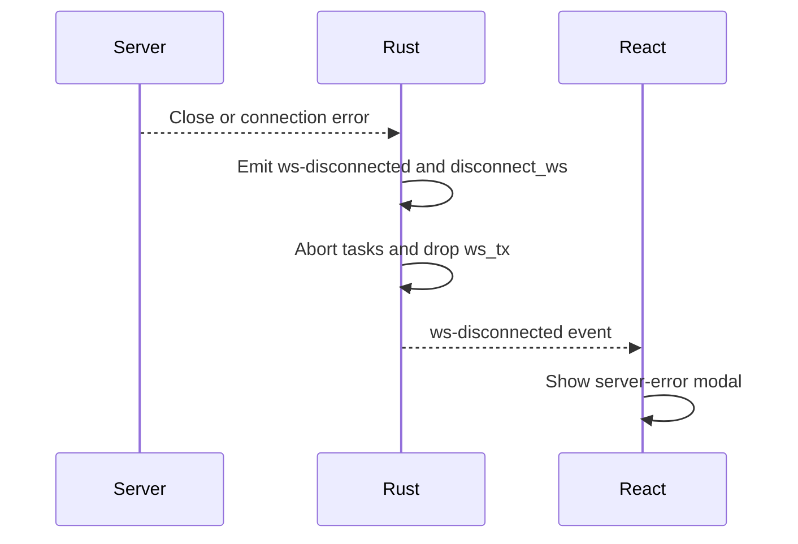
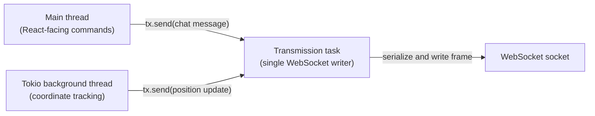

# GeoRuggine Client - Technical Manual

## 1. Introduction

### Purpose and scope

This manual documents the implementation of the GeoRuggine desktop client. It
covers the React/TypeScript frontend, the Tauri/Rust backend, internal IPC,
communication with the GeoRuggine server, asynchronous processing and tests.

The client authenticates users, maintains an authenticated WebSocket, sends
chat and position messages, and renders local application state. Persistence,
password hashing, message routing and route analysis belong to the server and
are not implemented in this client.

### Architectural overview

The client is a Tauri modular monolith. The React frontend and Rust backend are
packaged as one desktop application, but have separate responsibilities:

- React renders the interface and owns presentation state;
- Tauri provides the local command and event boundary;
- Rust owns HTTP authentication, the JWT, WebSocket transport and tracking;
- the external server provides the HTTP API and WebSocket endpoint.

## 2. Architecture and Project Structure

### 2.1 Frontend

#### Project structure

```text
src/
├── App.tsx
├── main.tsx
├── components/
│   ├── auth/
│   ├── chat/
│   └── upload/
├── services/
│   └── tauriBridge.ts
├── types/
├── integration/
└── test/
```

#### Main components and responsibilities

| Component or path | Responsibility |
| --- | --- |
| `App.tsx` | Authentication transitions, chat state, event listeners and server-error modal |
| `main.tsx` | React entry point |
| `components/auth/` | `AuthLayout`, `LoginForm` and `RegisterForm` |
| `components/chat/` | Sidebar, header, input, message list and message rendering |
| `components/upload/` | JSON file selection, upload and status feedback |
| `services/tauriBridge.ts` | Wrappers for Tauri `invoke` and `listen` |
| `types/auth.ts` | Frontend authentication interfaces |
| `types/chat.ts` | `ChatMessage` and local `UiMessage` |
| `integration/` | React-to-Tauri IPC integration tests |
| `test/` | Test setup and fake backend |

`ChatView` renders the message list and scrolls to the end when messages
change. `ChatInput` trims messages, rejects empty input, sends on plain Enter
and restores the input when sending fails. `ChatHeader` exposes Clear chat and
Logout. `ChatSidebar` exposes the chat tab and coordinate uploader.

#### State management

`App.tsx` stores:

- `currentUser`, containing only the username;
- the selected authentication view;
- the active tab;
- loading, authentication-error and success messages;
- `serverDown`;
- the local `UiMessage[]` conversation.

The frontend does not store the JWT. A local `UiMessage` contains an id,
sender information, display text, time and an optional `failed` flag.

#### Tauri bridge

`src/services/tauriBridge.ts` is the only frontend module that calls Tauri.
It wraps command invocation, event subscription and error normalization.

### 2.2 Native Backend

#### Project structure

```text
src-tauri/src/
├── auth/
│   ├── auth_service.rs
│   ├── commands.rs
│   ├── controller.rs
│   └── models.rs
├── messages/
│   ├── chatmessage/
│   ├── position/
│   └── dto.rs
├── websocket/
├── state.rs
├── lib.rs
└── main.rs
```

#### Modules and responsibilities

| Module | Responsibility |
| --- | --- |
| `auth/auth_service.rs` | HTTP registration and login |
| `auth/commands.rs` | Tauri commands and local input validation |
| `auth/controller.rs` | Authentication, WebSocket and session orchestration |
| `auth/models.rs` | Authentication DTOs and internal `UserSession` |
| `messages/chatmessage/` | Chat command, controller and `TextMessage` |
| `messages/position/` | Coordinate parsing, `PositionUpdate` and tracking |
| `messages/dto.rs` | `ClientIncomingMessage` enum |
| `websocket/mod.rs` | WebSocket connection, transmission, reception and events |
| `state.rs` | Shared session, queue sender and abort handles |
| `lib.rs` | Tauri setup, command registration and window cleanup |
| `main.rs` | Native executable entry point |

#### Commands, controllers and services

The backend separates responsibilities as follows:

- commands are the Tauri IPC boundary;
- controllers coordinate application behavior;
- `AuthService` performs HTTP requests;
- DTOs define serialized values exchanged with the server or frontend.

`lib.rs` registers these commands:

| Command | Input | Result |
| --- | --- | --- |
| `register` | username, password | `AuthResult` |
| `login` | username, password | `AuthResult` |
| `logout` | none | `Result<(), String>` |
| `get_current_user` | none | `Result<Option<String>, String>` |
| `send_chat_message` | contents | `Result<(), String>` |
| `upload_coordinates` | file content | `Result<(), String>` |

#### Shared state (`AppState`)

`AppState` is created once during Tauri setup and is registered as managed
state. Tauri commands receive a reference to it, while the Tokio tasks use
cloned references to access the same resources concurrently. The structure is
thread-safe because every shared value is wrapped in `Arc<Mutex<...>>`.

| Field | Type | Responsibility |
| --- | --- | --- |
| `session` | `Arc<Mutex<Option<UserSession>>>` | Stores the authenticated username and JWT. It is populated only after the HTTP login and WebSocket handshake succeed. |
| `ws_tx` | `Arc<Mutex<Option<UnboundedSender<ClientIncomingMessage>>>>` | Stores the sender of the unbounded MPSC channel. Chat commands and coordinate tracking use it to enqueue messages for the transmission task. `None` means that no active WebSocket channel is available. |
| `tracking_abort` | `Arc<Mutex<Option<AbortHandle>>>` | Identifies the background coordinate-tracking task and allows it to be stopped when tracking is replaced or the connection is closed. |
| `send_abort` | `Arc<Mutex<Option<AbortHandle>>>` | Identifies the task that consumes the MPSC receiver and writes outgoing JSON frames to the WebSocket. |
| `recv_abort` | `Arc<Mutex<Option<AbortHandle>>>` | Identifies the task that reads incoming WebSocket frames and emits Tauri events. |

`UserSession` is kept on the Rust side; it is not returned to React with the
login result. `ClientIncomingMessage` is the untagged enum used for values
queued by producers, such as chat messages and position updates. The sender
stored in `ws_tx` is the shared entry point for both the React-facing command
path and the coordinate-tracking task.

The state exposes the following operations:

| Method | Behavior |
| --- | --- |
| `save_session` | Locks `session` and stores a new `UserSession`. |
| `get_session` | Locks `session` and returns a clone of the current session. |
| `clear_session` | Locks `session` and removes the authenticated session. |
| `is_ws_connected` | Returns whether `ws_tx` currently contains a sender. |
| `send_ws_message` | Locks `ws_tx` and enqueues a `ClientIncomingMessage`; returns an error when the WebSocket is inactive or the receiver has been dropped. |
| `disconnect_ws` | Aborts tracking, transmission and reception, removes the sender from `ws_tx` and thereby destroys the shared channel handle. |

`disconnect_ws` is the central cleanup operation. It takes each abort handle
out of its mutex before calling `abort`, then sets `ws_tx` to `None`. Clearing
the sender prevents new messages from being enqueued after disconnection and
allows the transmission task's channel to terminate once its receiver is
also dropped.

### 2.3 Dependencies and Configuration

#### Main dependencies

The frontend uses React, React DOM, React-Bootstrap, Bootstrap,
`lucide-react`, Vite, TypeScript, Vitest and `@tauri-apps/api`.

| Rust crate | Responsibility |
| --- | --- |
| `tauri` | Desktop host, IPC, managed state and events |
| `serde` | Rust serialization and deserialization |
| `serde_json` | Coordinate parsing and WebSocket JSON |
| `reqwest` | HTTP authentication client |
| `tokio` | Async runtime, tasks, timers and MPSC |
| `tokio-tungstenite` | WebSocket client |
| `futures-util` | WebSocket `SinkExt` and `StreamExt` |
| `chrono` | UTC timestamps |

#### Tauri configuration

`src-tauri/tauri.conf.json` configures:

- product name `georuggine-client`;
- identifier `com.pds2026-g5.georuggine-client`;
- frontend distribution directory `../dist`;
- all bundle targets;
- window title `georuggine-client`;
- initial window size 800x600.

The `beforeBuildCommand` runs `npm run build`. `lib.rs` registers `AppState`
and calls `disconnect_ws` for `CloseRequested` and `Destroyed` window events.

## 3. Communication and Application Workflows

The communication architecture is divided between the React frontend, the
Tauri IPC boundary, the Rust backend and the external GeoRuggine server.
React communicates with Rust through commands and events. Rust performs the
HTTP requests and owns the WebSocket connection.

### 3.1 Internal Communication (React ↔ Rust)

#### Tauri commands (IPC)

The bridge invokes commands with Tauri `invoke`. Arguments are serialized by
Tauri and results are returned as promises.

| Bridge function | Tauri command | Purpose |
| --- | --- | --- |
| `apiRegister` | `register` | Submit registration |
| `apiLogin` | `login` | Authenticate and open WebSocket |
| `apiLogout` | `logout` | Disconnect and clear session |
| `apiGetCurrentUser` | `get_current_user` | Read username |
| `apiSendChatMessage` | `send_chat_message` | Queue chat message |
| `apiSendPosition` | `upload_coordinates` | Start tracking |

`AuthResult` exposes only `success` and `message`. The JWT is not part of the
IPC response.

#### Tauri events

| Event | Payload | Producer | Frontend action |
| --- | --- | --- | --- |
| `chat-message-received` | `TextMessage` | WebSocket reception task | Append server message |
| `ws-disconnected` | unit payload | WebSocket tasks | Set `serverDown` |

`App.tsx` installs listeners while `currentUser` is set and removes them when
the session ends or the component is unmounted. If listener registration
fails, it sets `serverDown`.

### 3.2 External Communication (Rust ↔ Server)

#### HTTP API and authentication

The HTTP base URL is `http://127.0.0.1:3000/api/v1`. `AuthService` creates a
`reqwest::Client`, sends JSON and deserializes `AuthResponse`.

| Method | Endpoint | Request | Response |
| --- | --- | --- | --- |
| `POST` | `/api/v1/auth/register` | `AuthRequest` | `AuthResponse` |
| `POST` | `/api/v1/auth/login` | `AuthRequest` | `AuthResponse` |

`AuthRequest` contains `username` and `password`. `AuthResponse` contains
`message` and an optional `token`. Connection, timeout and invalid-response
errors are converted into explicit messages.

#### WebSocket connection and protocol

After login, Rust connects to:

```text
ws://127.0.0.1:3000/api/v1/ws?token=<JWT>
```

`ClientIncomingMessage` is an untagged serde enum, so outgoing JSON frames do
not contain a `type` discriminator.

| DTO | Fields | Usage |
| --- | --- | --- |
| `TextMessage` | `contents: String`, `timestamp: String` | Chat frames |
| `PositionUpdate` | `lat: f64`, `lon: f64`, `timestamp: String` | Position frames |

Example chat frame:

```json
{
  "contents": "Hello",
  "timestamp": "2026-11-07T15:00:00Z"
}
```

Example position frame:

```json
{
  "lat": 45.0703,
  "lon": 7.6869,
  "timestamp": "2026-11-07T15:00:00Z"
}
```

Invalid incoming text frames are ignored by the reception task.

### 3.3 Application Workflows

#### Registration and login

**Registration trigger:** the user submits `RegisterForm`.

1. The form validates username, password length and confirmation.
2. `apiRegister` invokes the Rust `register` command.
3. Rust trims and validates input.
4. `AuthService` sends the registration request.
5. React receives `AuthResult`.

Registration does not create a WebSocket or session. On success, React
returns to the login view. On HTTP or validation failure, the registration
error remains visible.



**Login trigger:** the user submits `LoginForm`.

1. `apiLogin` invokes `login`.
2. Rust validates the credentials and `AuthService` sends the HTTP request.
3. Rust receives the JWT and opens the WebSocket.
4. `connect_ws_to` splits the socket into a sink for outgoing frames and a
   stream for incoming frames.
5. `UserSession` is saved only after the handshake succeeds.
6. React sets `currentUser` and installs the Tauri event listeners.

If the HTTP request or handshake fails, the session is not saved and React
remains on the login view. The JWT is kept in Rust and is not returned to
React.



After the WebSocket handshake, Rust creates the unbounded MPSC channel and
starts two Tokio tasks. The transmission task consumes messages from the
channel and sends them to the server through the WebSocket. The reception task
reads frames from the server and emits Tauri events for messages received by
React. The channel sender, `tx`, and the abort handles are stored in
`AppState`.

#### Coordinate upload and tracking

**Trigger:** the user selects a `.json` file and chooses Upload coordinates.

`FileUploader` validates the extension and reads the file as text. Rust
requires non-empty content, an active WebSocket and a non-empty JSON array.
`CoordinatePoint` maps `x`/`y` and accepts `lat`/`lon` as aliases.

`start_background_tracking` aborts the previous tracking task, stores a new
abort handle in `AppState`, and starts a Tokio task. The task creates
UTC-timestamped `PositionUpdate` values. Its first interval tick is immediate;
later points are queued on the same MPSC channel every 30 seconds. The
transmission task serializes and sends them through the existing WebSocket.
Tracking ends when all points are queued or the connection is unavailable.

The tracking task is a producer and never writes to the WebSocket directly.
This keeps coordinate transmission synchronized with chat transmission.



#### Chat messaging (sending and receiving)

**Sending trigger:** the user clicks Send or presses plain Enter.

`ChatInput` trims the text and `App.tsx` adds an optimistic `UiMessage`.
`send_chat_message` validates the contents, adds a UTC timestamp and creates a
`ClientIncomingMessage::Text`. It sends this value through the `tx` sender
stored in `AppState.ws_tx`. The transmission task receives the value, encodes
it with `serde_json` and writes the resulting `Message::Text` frame to the
WebSocket.

**Receiving trigger:** the reception task reads a WebSocket text frame.

The reception task deserializes `TextMessage` and emits
`chat-message-received`. The event listener in `App.tsx` formats the timestamp,
labels the sender as Server, rejects a duplicate with the same text and
displayed time, and appends a `UiMessage`.



#### Logout

**Logout trigger:** the user selects Logout.

Rust calls `disconnect_ws`, which aborts tracking, transmission and reception,
drops the WebSocket sender and then clears the session. React clears messages,
user state, authentication messages, active tab and `serverDown`.



#### Connection loss and application shutdown

**Connection loss trigger:** a WebSocket task detects a close or error.

The task emits `ws-disconnected` and calls `disconnect_ws`. React displays the
server-error modal and the Back to login action executes the logout reset path.
Window close events also call `disconnect_ws`; unlike explicit logout, they do
not call `clear_session`.



### 3.4 Concurrency

The React-facing command path and the background tracking task are concurrent
producers of WebSocket messages. Neither producer writes to the WebSocket
directly. Both use the `tx` sender stored in `AppState.ws_tx` to place a
`ClientIncomingMessage` in the internal unbounded MPSC channel.



The transmission task owns the WebSocket sink and is the only consumer that
writes frames. It waits on the receiver side of the channel, serializes each
message with `serde_json`, and sends it through the WebSocket. This ownership
model prevents the React command path and the tracking task from accessing the
same WebSocket sink concurrently.

- `AppState.ws_tx` contains an unbounded
  `tokio::sync::mpsc::UnboundedSender<ClientIncomingMessage>`;
- chat commands and tracking use the sender as producers;
- the transmission task is the single WebSocket writer and consumes the
  corresponding receiver;
- the reception task independently reads incoming frames and emits Tauri
  events;
- `Arc<Mutex<...>>` protects the sender and abort handles;
- `disconnect_ws` aborts tracking, transmission and reception, then drops the
  stored sender.

The reception task does not share the transmission sink. It reads the
WebSocket stream independently, deserializes valid `TextMessage` values and
notifies React with `chat-message-received`. This allows incoming messages to
be processed while the transmission task is sending queued chat or position
messages.

## 4. Testing

### Testing strategy

The project tests the React UI, bridge behavior, React-to-Tauri contracts and
Rust modules independently. Tests focus on observable behavior, DTO
serialization, state cleanup, command arguments and concurrent queueing.

### Frontend tests

Frontend tests cover `App.tsx`, authentication components, chat components,
the coordinate uploader and `tauriBridge.ts`. They use Vitest, Testing
Library, `user-event`, JSDOM and the shared test setup.

### Backend tests

Rust integration tests are in `src-tauri/tests/`:

| File | Coverage |
| --- | --- |
| `auth_tests.rs` | Sessions, logout and authentication DTOs |
| `chat_message_tests.rs` | Chat message behavior |
| `dto_tests.rs` | Message and position serialization |
| `position_tests.rs` | Coordinate and tracking behavior |
| `state_tests.rs` | Shared state operations |
| `websocket_channel.rs` | Queueing and concurrent producers |
| `websocket_integration.rs` | WebSocket pipeline integration |

### IPC integration tests

`src/integration/ipc.integration.test.tsx` mocks Tauri `invoke` and `listen`
and uses `FakeBackend`. It verifies registration, login, WebSocket failure,
chat forwarding, event delivery, coordinate upload, validation, logout and
local state reset.

### Build and test commands

Run from `georuggine-client/`:

```bash
npm test
npm run test:coverage
npm run build
```

`npm run build` runs TypeScript compilation followed by `vite build`.
