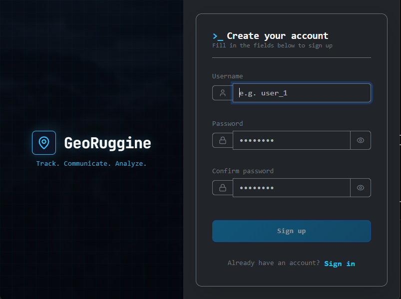
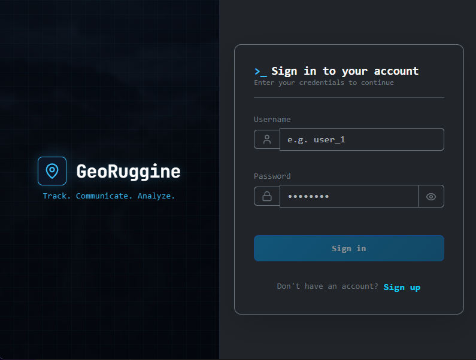
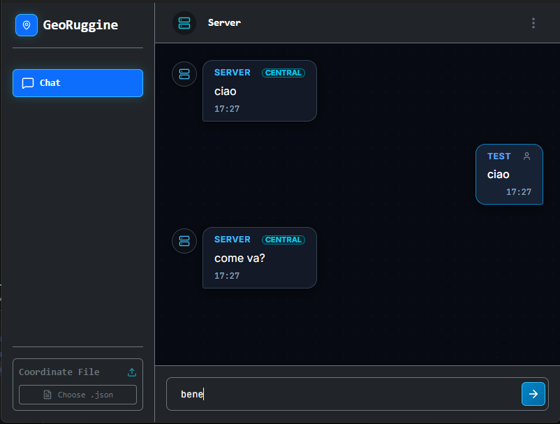
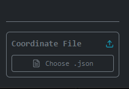
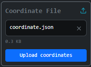
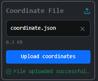
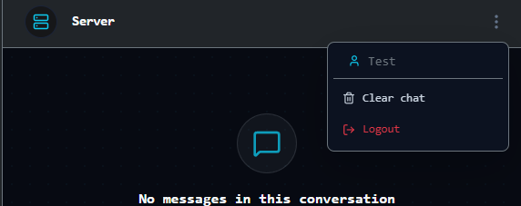
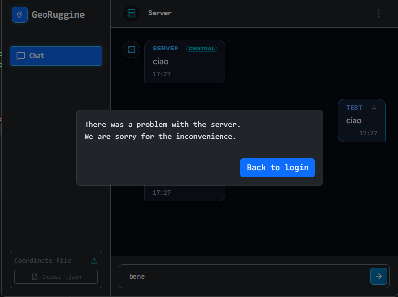

# GeoRuggine Client - User Manual

This document explains how to install, start and use the GeoRuggine desktop
client.

## Downloading the Client

Download the latest GeoRuggine client release for your operating system from
the project's **Releases** page:

- Linux: download the Linux package;
- Windows: download the Windows installer or executable;
- macOS: download the macOS package.

Choose the latest available version and download the file corresponding to your
operating system.

## Launching the Client

After downloading the client and starting the GeoRuggine server, launch the
executable for your operating system.

### Linux

Open a terminal in the directory containing the client executable and run:

```bash
./georuggine-client
```

If necessary, grant execution permission first:

```bash
chmod +x georuggine-client
```

### Windows

Open PowerShell in the directory containing the client executable and run:

```powershell
.\georuggine-client.exe
```

The login screen is displayed when the client starts.

## Authentication

You must have an account to use the application.

### Registering an account

1. Select **Register** on the login screen.
2. Enter a username.
3. Enter a password containing at least four characters.
4. Confirm the registration.

If the registration is successful, return to the login screen and use the new
credentials.



### Logging in

1. Open the **Login** screen.
2. Enter the username and password of an existing account.
3. Select **Login**.

After a successful login, the main application screen opens.



## Chat

The chat allows you to exchange text messages with the server and other
connected users.

1. Type a message in the chat input.
2. Select **Send** or press the corresponding send key.
3. Read received messages in the chat area.

Messages appear with their timestamp. If a message cannot be sent, it remains
available in the input so you can try again.



### Clearing the chat

To remove all messages currently shown in the chat:

1. Open the chat menu.
2. Select **Clear chat**.

This clears the conversation from the current client view. It does not delete
messages already stored by the server, and newly received messages can still
appear in the chat.

## Uploading a Coordinate Route

The coordinate upload feature lets you share a route with the server.

### Step 1: Prepare the coordinate file

Create a JSON file containing an ordered list of positions. The accepted
canonical format is:

```json
[
  { "x": 45.0703, "y": 7.6869 },
  { "x": 45.2, "y": 8.5 },
  { "x": 45.4641, "y": 9.1919 }
]
```

The aliases `lat` and `lon` are also accepted:

```json
[
  { "lat": 45.0703, "lon": 7.6869 },
  { "lat": 45.4641, "lon": 9.1919 }
]
```

The client sends the first position immediately and then sends one position
every 30 seconds while the route is active.

The coordinate file must:

- use the `.json` extension;
- contain valid JSON;
- contain a non-empty root array;
- contain numeric coordinates;
- be uploaded while you are connected.

### Step 2: Choose the JSON file

In the **Coordinate File** panel, select **Choose .json**. This opens the file
picker, which only accepts files with the `.json` extension.



### Step 3: Confirm the selected file

Select the route file in the file picker. The panel then displays the selected
filename and its size. Check that the correct file is shown before starting
the upload.



### Step 4: Upload the coordinates

Select **Upload coordinates**. The client reads the file, validates it and
starts sending the route through the active connection. The upload button is
temporarily disabled while the operation is in progress.

When the operation starts successfully, the panel displays **File uploaded
successfully!**.



The client continues sending the remaining positions every 30 seconds until
the file is finished. Uploading a new file replaces the route currently being
sent. Route sending stops automatically when all positions have been sent,
when you log out or when you close the application.

## Logging Out

Select **Logout** to end your session and return to the login screen. Any
active route upload is stopped.



## Connection Errors

If the connection to the server is lost, the client displays an error message.
Select **Back to login**, check that the server is available, and log in again.


