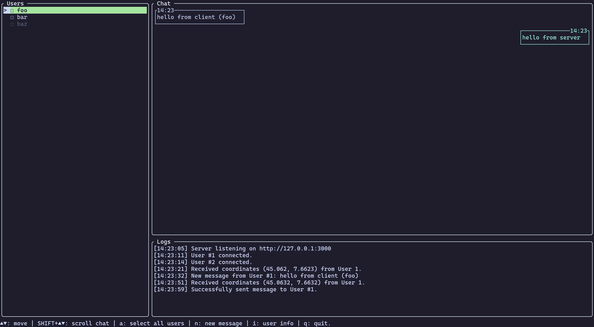
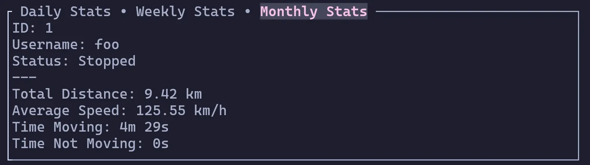

# GeoRuggine Server - User Manual

This document provides instructions on how to configure, build, and run the GeoRuggine server application.

## System Requirements

- Supported OS: Linux, macOS, Windows
- Rust toolchain (see https://rust-lang.org/tools/install/)

## Environment Configuration

The server requires specific environment variables to operate correctly. You can define these variables in a `.env` file located in the same directory as the executable file or export them directly in your environment.

| Variable     | Description                                   | Example                   |
| ------------ | --------------------------------------------- | ------------------------- |
| `HOST`       | The IP address the server will bind to        | `127.0.0.1`               |
| `PORT`       | The port for HTTP and WebSocket traffic       | `3000`                    |
| `DB_URL`     | SQLite database connection string             | `data/georuggine.db`      |
| `LOG_FILE`   | Path to the output log file                   | `logs/server.log`         |
| `JWT_SECRET` | Secret key used to sign authentication tokens | `your_secure_secret_here` |

> **Note:** The server automatically creates the target database and log file directories if they don't already exist.

## Running the Server

### Using Pre-compiled Binaries

1. Download the latest binary for your operating system from the Releases section.
2. Ensure the required environment variables are set or a valid `.env` file is present in the working directory.
3. Execute the binary:

```bash
# On Linux/macOS
./georuggine-server

# On Windows
georuggine-server.exe
```

### Building from Source

1. Clone the repository and navigate to the project directory.
2. Build the server in release mode:

   ```bash
   cargo build --release
   ```

3. The compiled executable will be available at `./target/release/georuggine-server`.
4. Copy the `.env.template` file to `.env` and adjust the values as needed:

   ```bash
   cp .env.template .env
   ```

## Terminal User Interface

The application presents itself as follows.



### User list

The widget on the left shows all the users that have registered an account in the system. Users have different colors based on their current state:

- **Green**: the user is online and is _moving_.
- **Light gray**: the user is online but is _not moving_.
- **Dark gray**: the user is _offline_.

You can scroll through users using the arrow keys or J/K if you prefer Vim bindings.

### Sending messages

The application allows the server to send _text messages_ to all the connected users. This is done in two steps:

1. First, select the users you want to communicate with by selecting them by pressing `SPACE`.
2. Then, press the `n` key: this will open a popup where you can type the contents of the message.

To broadcast a message without selecting users individually, press `a` to select all connected users at once.

### Viewing user info

To view movement statistics for a specific user, highlight their entry in the list and press `i`. This opens a popup displaying key metrics, including

- total distance traveled
- average speed.
- active and idle time

These statistics can be viewed across daily, weekly, and monthly timeframes. You can cycle through time frames by using the left and right arrow keys (or H/L if you prefer Vim bindings).



### Reading the chat

Messages appear as they are received by the server. When the space in the chat box runs out, you can scroll through messages by using `SHIFT+▲▼` (or `SHIFT+j/k`).
